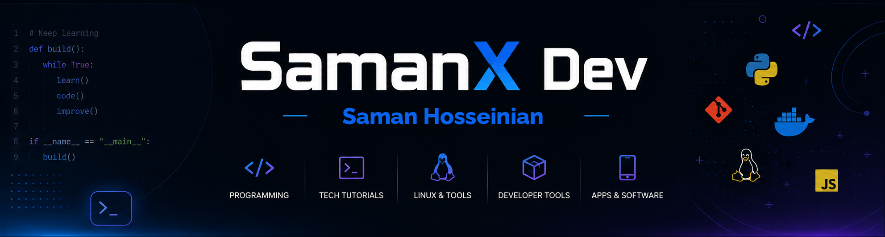

  

 

<h1 align="center">Hey, I'm Saman 👋</h1>

<h3 align="center">
  Software Developer | Backend Developer | Web Designer
</h3>

  Building modern web experiences and developing reliable software.
   
  Passionate about clean code, thoughtful design, and exploring new technologies.

  
  
  

---

<h2 align="center">🛠️ Tech Stack & Tools</h2>

<h3 align="center">💻 Development</h3>

  

<h3 align="center">🎨 Design & Creative Tools</h3>

  

---

<h2 align="center">🚀 Featured Projects</h2>

<table align="center">
  <tr>
    <td width="50%" valign="top">
      <h3 align="center">📬 Postino</h3>
      

        A postal management system featuring tracking codes and mail delivery records.
      

      

        
        
      

      

        
      

    </td>
    <td width="50%" valign="top">
      <h3 align="center">🛡️ Veil VPN</h3>
      

        A privacy-focused desktop VPN application with a modern user interface.
      

      

        
        
      

      

        
      

    </td>
  </tr>
</table>

---

<h2 align="center">📊 GitHub Activity</h2>

  
  

  

---

<h2 align="center">📫 Let's Connect</h2>

  
  

 

  <i>Building today. Innovating tomorrow.</i>

